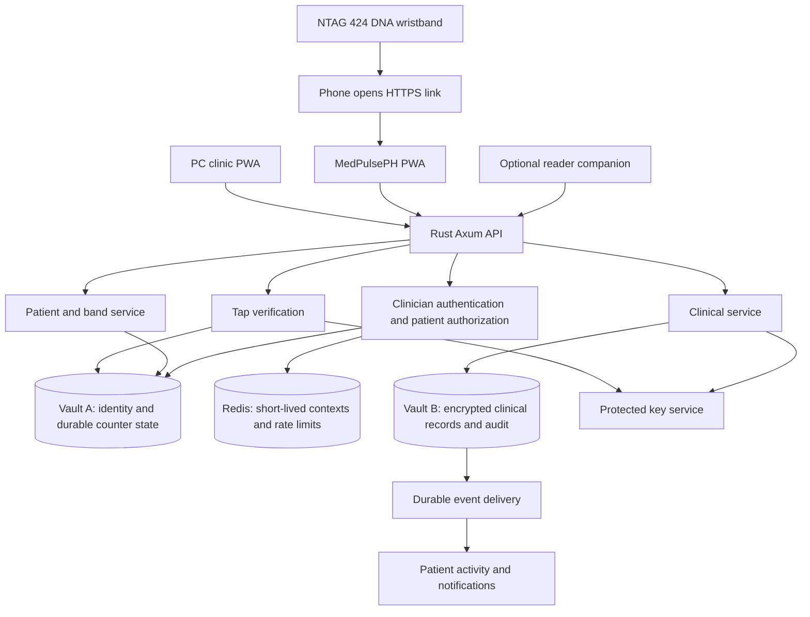

# 2. Target system architecture

**Status:** Planning requirements; implementation not started.

[Plan index](../../IMPLEMENTATION_PLAN.md) | [Iteration packages](ITERATIONS.md) | Primary package: I04

---

Start with a modular Rust application using Axum, Tokio, SQLx, Redis, typed errors, and distinct `IdentityPool` and `ClinicalPool` types. Use separate databases, credentials, permissions, and backup access. A process with access to both vaults remains a shared compromise boundary; consider stronger service separation if the threat model requires it.

The initial local Docker stack and its limits are described in [I04 Docker development](I04-DOCKER-DEVELOPMENT.md). It provides separate development containers and connection pools; it does not implement clinical access or production isolation.

The PWA uses TypeScript, React Native for Web, Expo tooling, and Expo Router. Provide a web manifest and deliberately limited service worker. Abstract NFC, notifications, installation, connectivity, and reader pairing behind platform-specific interfaces so later native apps can reuse workflows. Test library compatibility rather than assuming all React Native dependencies work on the web.

Use secure, HttpOnly cookies with suitable SameSite settings and CSRF protection; hold doctor OAuth tokens server-side where feasible. Never store PINs, authentication tokens, or clinical records in browser local storage. Exclude clinical and authentication responses from service-worker caches. Redact sensitive data and tap proofs from logs, analytics, and error reporting. See [Expo PWA guidance](https://docs.expo.dev/guides/progressive-web-apps/) and [OWASP session management](https://cheatsheetseries.owasp.org/cheatsheets/Session_Management_Cheat_Sheet.html).
